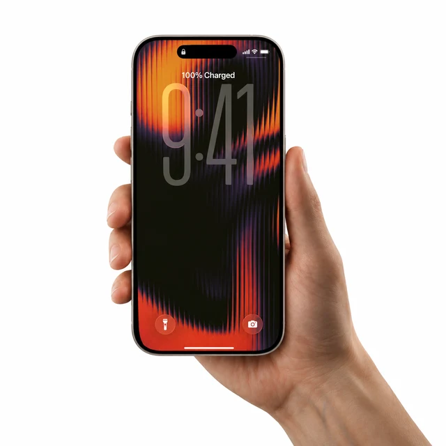
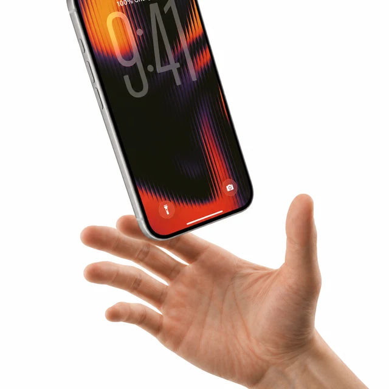
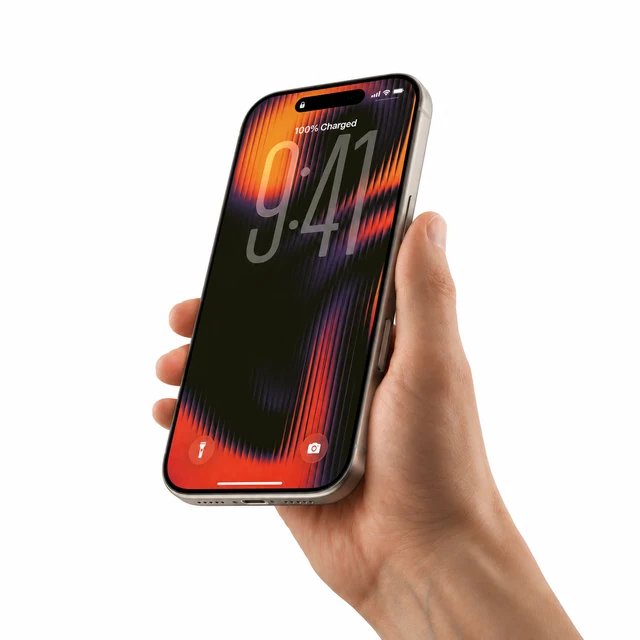

# 接住 / Hand Catch 参考分析

## 素材与目标

- 构图和节奏参考 Jose Sáez Merino 用 Matte app 制作的实时 3D 演示。[原帖](https://x.com/josesaezmerino/status/2117964564285317500)
- B2W 于 2026-11-20 制作。发布成片为 18 秒、1080 × 1080、30 fps、540 帧、无声。
- 手机斜落，右手接住并转正。停顿后绕转视角，随后从斜侧重播并停住。

## 阶段表

时间以成片为准。除硬切外，区间按暂停帧近似标记，动作之间有重叠。帧号从 0 起算。

| 时间（秒） | 成片帧号 | 阶段 | 可见证据与节奏 | 置信度 |
| --- | --- | --- | --- | --- |
| 0–约 1.33 | 0–39 | 下落、张手 | 手机沿倾斜姿态自上方入画。手同时从右下向上伸，手指张开，双方朝画面中间靠拢。 | 高 |
| 约 1.33–3.5 | 40–104 | 接住、转正 | 手机与掌前的空隙消失，手指沿手机边缘收拢，手机向竖直转动并减速。 | 高 |
| 约 3.5–4.4 | 105–131 | 稳定停留 | 握姿和构图趋于稳定，视角开始转动之前有停顿。 | 中 |
| 约 4.4–11.31 | 132–339 | 拖动转视角 | 手机与手共用稳定握姿。屏幕宽度、倾角和可见侧边变化，转动的快慢随拖动变化，切换前趋稳。 | 高 |
| 11.31 | 340 起显示新镜头 | 硬切 | 从已握住的手机切到斜侧镜头中刚入画的手机和伸入的手。时间线切点为 11.31 秒，30 fps 的新镜头首帧位于 11.333 秒。 | 高 |
| 11.31–约 14 | 340–419 | 斜侧重播 | 斜侧视角下，手机再次从上方落向张开的手。闭合后手保持握持。 | 高 |
| 约 14–18 | 420–539 | 回稳、停住 | 手和手机有轻微回稳，最终以斜侧握持姿态停住。 | 中 |

## 画面与衔接

方形画幅中，手机从上边界入画，前臂由右下边界进入并延伸出画。手指与手机边缘的遮挡随握持和绕转变化，白底贯穿两镜。片中跨段速度以参考片逐帧实测曲线为依据，先将每段素材按光流运动量重排，再在关键帧接口内以 ±0.06 秒形变衔接。剪辑使用 180° 快门运动模糊。斜侧重播中出现的「接住又松手」以相似帧剪接修复。

用 FFprobe 核对原始成片和发布文件，用 FFmpeg 在多个时刻抽帧，并用 30 fps 检查硬切所在帧。下图来自本项目生成的关键帧。

| 手部定妆 | 张手迎接 | 斜侧停稳 |
| --- | --- | --- |
|  |  |  |

## 不确定项

- 接触、转正结束与停顿开始的交界在连续画面中重叠，表内时间按关键帧和暂停观察取近似值。
- 仅凭画面不能确定参考演示的拖动输入与 3D 相机参数。剪辑用画面光流估计速度。
