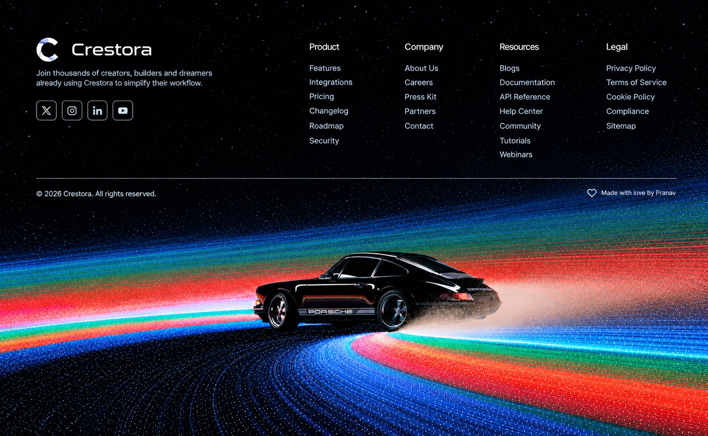

# 流光赛道 / Prism Road

灵感来自 Pranav 的 Crestora 页脚设计。参考图左下的蓝色细弧穿过车底，右侧彩带在车后展开。原图里的粉白烟和车漆高光决定了动效的配色。原始静帧为 1597 × 985。

## 从静帧到定稿

| 开发阶段 | 画面处理与取舍 |
| --- | --- |
| 拆层与流向 | 擦除页脚文字与车身字样，分离透明车身、底板、车底阴影和轮毂。按远景、S 弯、近景宽带分别标注导线。 |
| V3–V5 | 试过粒子组成光束、二维纹理平流和完整三维场景。粒子版本在白点间留出暗隙，三维版本改变了车漆和路面的原图质感。 |
| V6 | 回到原图拆层。动态道路先进入离屏缓冲，车漆和玻璃再从同一缓冲采样。暗轨、星空、轮毂和车尾烟尘分别运动。 |
| V7 定稿 | 同一条带宽共享行程和明暗相位，让光带本体与白点同时前进。采用 D 整带涌动、粒子中、B 高速轮、反光中、星星明显。 |

## 同一帧内的运动

所有层从 0 秒起同时运行。每层有自己的局部周期，实时画面持续演化。8 秒卡片用 0.5 秒交叉淡化衔接首尾。

| 层 | 原图坐标和时序 |
| --- | --- |
| 路面与亮点 | 双相流场回采保留细纹。整带涌动以 130 / 395 px/s 穿过远、近景，粒子按各自路径的原始速率插值。 |
| 星空 | 按 1.5 倍原星点数绘制，最亮 4% 带星芒。各星相位独立，少数有短促眨眼。 |
| 车身与车轮 | 车漆采用中档 1.0 倍菲涅尔环境反射。椭圆轮毂采样角向曝光图，前、后轮分别以 11.7 / 11.1 rad/s 转动。 |
| 车尾 | 保留原图粉白烟色，以 2.8 秒双相平流表现内部翻卷。九处发射点按固定随机种子喷出、扩散并消隐扬尘。 |

## 已知限制

参考图只提供一个机位。车身法线、轮毂透视和被遮挡区域均由该机位估算。手机竖屏优先保留整车，左右两端的彩带会被裁切。较慢 GPU 会逐级降低道路缓冲分辨率，保留车身和粒子的输出分辨率。无 WebGL2 时使用固定机位的 H.264 录制版。For AI 采用 Described 级，参数是定稿常量。

[展示页](../../site/prism-road.html) · [复刻说明](../../site/prism-road/for-ai.html) · [组件描述](../../site/effects/prism-road.component.json)
